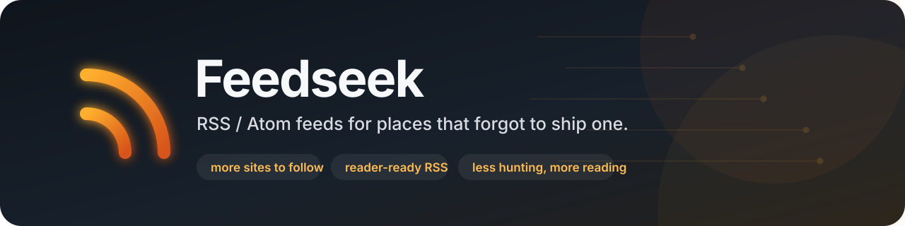
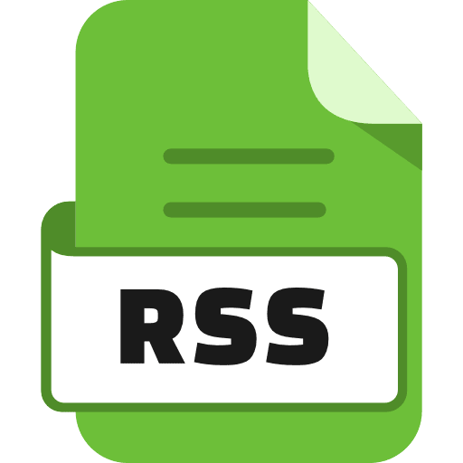

> [!WARNING]
> ⚠️ Public feeds: `https://rss.bartek.lol/{feed}.xml`. GitHub Pages is the backend; old subscription URLs still work.

# Feedseek :satellite:

**Self-updating, enhanced RSS/Atom feeds with a single LLM-friendly JSON Model Feed for each source. Built both where feeds are missing and where native feeds can be made better.**

      
  
  
 

  

[Polski](README_pl.md) · **English** · [简体中文](README_zh.md)  

[**:satellite: Feeds**](https://rss.bartek.lol/) · [**:book: Reader**](https://rss.bartek.lol/reader/) · [**:card_file_box: Registry**](feeds.yaml) · [**:robot: LLMs**](docs/model-feeds.md) · [**:compass: Internals**](docs/)

Feedseek discovers or builds feeds, normalizes entries, deduplicates them and publishes the generated output through GitHub Pages. The scheduled workflow refreshes sources every two hours, while source failures are isolated so one broken site does not sink the rest.

Feedseek is not only a generator for sites that lack feeds. Native RSS/Atom is a valuable upstream input, not an untouchable final product: when the source material allows it, Feedseek normalizes and enriches it into a more stable, complete, expressive and interoperable feed, with a single compact LLM-friendly JSON Model Feed alongside the XML. Its `feed_<name>.json` sibling provides normalized plaintext, explicit text-kind metadata, canonical links and timestamps for LLM and agent consumption. It replaces the previous JSON Feed 1.1 and `.model.json` pair.

The goal is to use the useful semantics of RSS, Atom and JSON Feed as fully as the source allows: durable identity, canonical links, truthful publication/update dates, useful metadata, provenance, categories and media. Scraping and API adapters fill gaps that native sources leave behind. A failed or empty fetch does not replace the last known-good feed.

Inspired by [Olshansk/rss-feeds](https://github.com/Olshansk/rss-feeds) & [rss-bridge/rss-bridge](https://github.com/rss-bridge/rss-bridge).

## Feeds 

| Source  | Feed  |
| ------ | ---- |
|  [Jbzd.com.pl](https://jbzd.com.pl/) | [jbzd.xml](https://rss.bartek.lol/jbzd.xml) |
|  [Wykop](https://wykop.pl/) | [wykop.xml](https://rss.bartek.lol/wykop.xml) |
|  [9GAG](https://9gag.com/) | [9gag.xml](https://rss.bartek.lol/9gag.xml) |
|  [4chan](https://www.4chan.org/) | [4chan.xml](https://rss.bartek.lol/4chan.xml) |
|  [Lemmy](https://join-lemmy.org/) | [lemmy.xml](https://rss.bartek.lol/lemmy.xml) |
|  [Cheezburger Network](https://www.cheezburger.com/) | [cheezburger.xml](https://rss.bartek.lol/cheezburger.xml) |
|  [Memedroid](https://www.memedroid.com/) | [memedroid.xml](https://rss.bartek.lol/memedroid.xml) |
|  [Memy (Memy.pl · Jeja.pl · Kwejk.pl)](https://memy.pl/) | [memy.xml](https://rss.bartek.lol/memy.xml) |
|  [Beatport Top 100](https://www.beatport.com/top-100) | [beatport.xml](https://rss.bartek.lol/beatport_top100.xml) |
|  [RA (Resident Advisor)](https://ra.co/magazine) | [ra.xml](https://rss.bartek.lol/ra.xml) |
|  [Audio.com.pl](https://audio.com.pl/) | [audio.xml](https://rss.bartek.lol/audio.xml) |
|  [Audacity®](https://www.audacityteam.org/blog/) | [audacity.xml](https://rss.bartek.lol/audacity.xml) |
|  [Spotify (newsroom + developers)](https://newsroom.spotify.com/) | [spotify.xml](https://rss.bartek.lol/spotify.xml) |
|  [Netflix](https://about.netflix.com/) | [netflix.xml](https://rss.bartek.lol/netflix.xml) |
|  [foobar2000](https://www.foobar2000.org/news) | [foobar2000.xml](https://rss.bartek.lol/foobar2000.xml) |
|  [Daily Digest](https://api.viewbits.com/) | [digest.xml](https://rss.bartek.lol/daily_digest.xml) |
|  [Daily Quote](https://gist.github.com/trvny/167d2271e3cf7d21e118aa7d906a7d2c) | [quote.xml](https://rss.bartek.lol/daily_quote.xml) |
|  [Quotes, Sayings & Jokes of the Day](https://theysaidso.com/) | [theysaidso.xml](https://rss.bartek.lol/theysaidso.xml) |
|  [Word of the Day (Dictionary.com,MW,AWAD,TFD)](https://www.dictionary.com/e/word-of-the-day/) | [wotd.xml](https://rss.bartek.lol/wotd.xml) |
|  [Unsplash (log + wallpapers)](https://unsplash.com/blog/) | [unsplash.xml](https://rss.bartek.lol/unsplash.xml) |
|  [Open-Meteo](https://open-meteo.com/) | [open_meteo.xml](https://rss.bartek.lol/open_meteo.xml) |
|  [OpenWeather](https://openweathermap.org/city/3093133) | [openweather.xml](https://rss.bartek.lol/openweather.xml) |
|  [Visual Crossing](https://www.visualcrossing.com/) | [visualcrossing.xml](https://rss.bartek.lol/visualcrossing.xml) |
|  [IMGW](https://danepubliczne.imgw.pl/) | [imgw.xml](https://rss.bartek.lol/imgw.xml) |
|  [Weather — Kościelec](https://weather.bartek.lol/) | [weather.xml](https://rss.bartek.lol/weather.xml) |
|  [AccuWeather News](https://www.accuweather.com/en/weather-news) | [accuweather.xml](https://rss.bartek.lol/accuweather.xml) |
|  [Xweather Log](https://www.xweather.com/blog) | [xweather.xml](https://rss.bartek.lol/xweather.xml) |
|  [Visual Crossing Blog](https://www.visualcrossing.com/resources/) | [visualcrossing_blog.xml](https://rss.bartek.lol/visualcrossing_blog.xml) |
|  [Reuters](https://www.reuters.com/) | [reuters.xml](https://rss.bartek.lol/reuters.xml) |
|  [The Independent](https://www.independent.co.uk/) · [Indy100](https://www.indy100.com/) | [independent.xml](https://rss.bartek.lol/independent.xml) |
|  [Newsify](https://newsify.today/polish/PL) | [newsify.xml](https://rss.bartek.lol/newsify.xml) |
|  [WSJ](https://www.wsj.com/news/latest-headlines?mod=wsjfooter) | [wsj.xml](https://rss.bartek.lol/wsj.xml) |
|  [Euronews](https://www.euronews.com/) | [euronews.xml](https://rss.bartek.lol/euronews.xml) |
|  [PAP](https://www.pap.pl/) | [pap.xml](https://rss.bartek.lol/pap.xml) |
|  [TVP](https://www.tvp.pl/) | [tvp.xml](https://rss.bartek.lol/tvp.xml) |
|  [Geopolitics (ISW;RUSI;CSIS;Carnegie)](https://understandingwar.org/research/) | [geopolitics.xml](https://rss.bartek.lol/geopolitics.xml) |
|  [Gov.pl](https://www.gov.pl/) | [govpl.xml](https://rss.bartek.lol/govpl.xml) |
|  [US.gov](https://www.usa.gov/) | [usgov.xml](https://rss.bartek.lol/usgov.xml) |
|  [Europa (UE)](https://european-union.europa.eu/) | [europa.xml](https://rss.bartek.lol/europa.xml) |
|  [Dwutygodnik](https://www.dwutygodnik.com/) | [dwutygodnik.xml](https://rss.bartek.lol/dwutygodnik.xml) |
|  [Polskie Radio – Trójka](https://trojka.polskieradio.pl/) | [trojka.xml](https://rss.bartek.lol/trojka.xml) |
|  [Polskie Radio – Czwórka](https://www.polskieradio.pl/10,czworka) | [czworka.xml](https://rss.bartek.lol/czworka.xml) |
|  [Radios (TuneIn;Maxi Italo;Electro Swing)](https://tunein.com/) | [radios.xml](https://rss.bartek.lol/radios.xml) |
|  [Download Soundtracks](https://download-soundtracks.com/) | [download-soundtracks.xml](https://rss.bartek.lol/download-soundtracks.xml) |
|  [YouTubs (selected channels, no Shorts)](https://www.youtube.com/) | [youtubs.xml](https://rss.bartek.lol/youtubs.xml) |
|  [FFmpeg](https://ffmpeg.org/) | [ffmpeg.xml](https://rss.bartek.lol/ffmpeg.xml) |
|  [Wikipedia (PL)](https://pl.wikipedia.org/) | [wikipedia.xml](https://rss.bartek.lol/wikipedia_pl.xml) |
|  [Baidu Baike 热搜词条](https://baike.baidu.com/) | [baidubaike.xml](https://rss.bartek.lol/baidubaike.xml) |
|  [V2EX + sspai](https://www.v2ex.com/) | [v2ex.xml](https://rss.bartek.lol/v2ex.xml) |
|  [Medium](https://medium.com/) | [medium.xml](https://rss.bartek.lol/medium.xml) |
|  [OLX Group (OLX/OTOMOTO/Otodom)](https://www.olx.pl/) | [olx.xml](https://rss.bartek.lol/olx.xml) |
|  [Toyota Global](https://pressroom.toyota.com/) | [toyota.xml](https://rss.bartek.lol/toyota.xml) |
|  [Lexus Newsroom](https://pressroom.lexus.com/) | [lexus.xml](https://rss.bartek.lol/lexus.xml) |
|  [AI-bridge (combined AI sources)](https://thinkingmachines.ai/blog/) | [aibridge.xml](https://rss.bartek.lol/aibridge.xml) |
|  [Anthropic](https://www.anthropic.com/) | [anthropic.xml](https://rss.bartek.lol/anthropic.xml) |
|  [Claude](https://claude.com/blog) | [claude.xml](https://rss.bartek.lol/claude.xml) |
|  [OpenAI](https://openai.com/news/) | [openai.xml](https://rss.bartek.lol/openai.xml) |
|  [xAI](https://x.ai/news) | [xai.xml](https://rss.bartek.lol/xai.xml) |
|  [Alibaba](https://www.alibabacloud.com/en/press-room/press-release) | [alibaba.xml](https://rss.bartek.lol/alibaba.xml) |
|  [Hugging Face](https://huggingface.co/) | [huggingface.xml](https://rss.bartek.lol/huggingface.xml) |
|  [LLM & MCP / Skills ecosystem](https://skillsllm.com/) | [skillsllm.xml](https://rss.bartek.lol/skillsllm.xml) |
|  [Molt](https://www.moltbook.com/) | [molt.xml](https://rss.bartek.lol/molt.xml) |
|  [arXiv (+LessWrong;80,000Hours)](https://arxiv.org/) | [arxiv.xml](https://rss.bartek.lol/arxiv.xml) |
|  [Spider's Web](https://spidersweb.pl/) | [spidersweb.xml](https://rss.bartek.lol/spidersweb.xml) |
|  [Foundry (CSO,PCWorld)](https://foundryco.com/sitemap/) | [foundry.xml](https://rss.bartek.lol/foundry.xml) |
|  [Lenovo StoryHub](https://news.lenovo.com/) | [lenovo.xml](https://rss.bartek.lol/lenovo.xml) |
|  [NVIDIA (newsroom, blogs + GeForce drivers)](https://nvidianews.nvidia.com/) | [nvidia.xml](https://rss.bartek.lol/nvidia.xml) |
|  [DJI](https://www.dji.com/pl/mobile/media-center/announcements) | [dji.xml](https://rss.bartek.lol/dji.xml) |
|  [HP Newsroom](https://www.hp.com/us-en/newsroom.html) | [hp.xml](https://rss.bartek.lol/hp.xml) |
|  [Xiaomi Newsroom](https://www.mi.com/global/discover/newsroom) | [xiaomi.xml](https://rss.bartek.lol/xiaomi.xml) |
|  [Samsung Newsroom (global/PL)](https://news.samsung.com/global/) | [samsung.xml](https://rss.bartek.lol/samsung.xml) |
|  [Sony Corp](https://www.sony.com/en/SonyInfo/News/Press/) | [sony.xml](https://rss.bartek.lol/sony.xml) |
|  [Apple Newsroom](https://www.apple.com/pl/newsroom/) | [apple.xml](https://rss.bartek.lol/apple.xml) |
|  [Microsoft Blogs](https://blogs.microsoft.com/) | [microsoft.xml](https://rss.bartek.lol/microsoft.xml) |
|  [Microsoft Updates (Windows/Office/Copilot)](https://support.microsoft.com/en-us/windows) | [ms-updates.xml](https://rss.bartek.lol/ms-updates.xml) |
|  [Google (combined)](https://blog.google/) | [google.xml](https://rss.bartek.lol/google.xml) |
|  [YouTube Blog](https://blog.youtube/) | [youtube.xml](https://rss.bartek.lol/youtube.xml) |
|  [TikTok](https://newsroom.tiktok.com/) | [tiktok.xml](https://rss.bartek.lol/tiktok.xml) |
|  [Meta Newsroom](https://about.fb.com/news/) | [meta.xml](https://rss.bartek.lol/meta.xml) |
|  [Uber Newsroom](https://www.uber.com/us/en/newsroom/) | [uber.xml](https://rss.bartek.lol/uber.xml) |
|  [Tencent](https://www.tencent.com/newsroom/) | [tencent.xml](https://rss.bartek.lol/tencent.xml) |
|  [Palantir](https://www.palantir.com/newsroom/) | [palantir.xml](https://rss.bartek.lol/palantir.xml) |
|  [Bank Pekao SA](https://www.pekao.com.pl/) | [pekao.xml](https://rss.bartek.lol/pekao.xml) |
|  [Red Hat Enterprise](https://www.redhat.com/en/) | [redhat.xml](https://rss.bartek.lol/redhat.xml) |
|  [Ubuntu](https://ubuntu.com/blog) | [ubuntu.xml](https://rss.bartek.lol/ubuntu.xml) |
|  [Oracle](https://blogs.oracle.com/) | [oracle.xml](https://rss.bartek.lol/oracle.xml) |
|  [Mozilla](https://blog.mozilla.org/) | [mozilla.xml](https://rss.bartek.lol/mozilla.xml) |
|  [AWS](https://aws.amazon.com/blogs/) | [aws.xml](https://rss.bartek.lol/aws.xml) |
|  [Cloudflare (log/community/research)](https://blog.cloudflare.com/) | [cloudflare.xml](https://rss.bartek.lol/cloudflare.xml) |
|  [Docker](https://www.docker.com/blog/) | [docker.xml](https://rss.bartek.lol/docker.xml) |
|  [GitLab](https://about.gitlab.com/) | [gitlab.xml](https://rss.bartek.lol/gitlab.xml) |
|  [GitHub (tooling,trending)](https://github.blog/) | [github.xml](https://rss.bartek.lol/github.xml) |
|  [trvny + travnie · GitHub milestones](https://github.com/trvny) | [trvny.xml](https://rss.bartek.lol/trvny.xml) |
|  [Development (Rust,Django,ReactNative&more)](https://blog.rust-lang.org/) | [development.xml](https://rss.bartek.lol/development.xml) |
|  [APIs](https://publicapis.dev/blog) | [apis.xml](https://rss.bartek.lol/apis.xml) |
|  [Open Sources (CC/OSI/SPDX/OGC/RFC/IETF)](https://creativecommons.org/blog/) | [opensource.xml](https://rss.bartek.lol/opensource.xml) |
|  [HackerOne](https://www.hackerone.com/blog) | [hackerone.xml](https://rss.bartek.lol/hackerone.xml) |
|  [Python (combined ecosystem)](https://www.python.org/) | [python.xml](https://rss.bartek.lol/python.xml) |
|  [JS \| Node (ecosystem)](https://nodejs.org/) | [js_node.xml](https://rss.bartek.lol/js_node.xml) |
|  [RSS Boards](https://www.rssboard.org/) | [rssboard.xml](https://rss.bartek.lol/rssboard.xml) |
|  [SaaS vendors](https://www.hashicorp.com/blog) | [saas.xml](https://rss.bartek.lol/saas.xml) |
|  [OPENOFFICE](https://www.onlyoffice.com/blog) | [openoffice.xml](https://rss.bartek.lol/openoffice.xml) |
|  [Canva](https://www.canva.com/newsroom/news/) | [canva.xml](https://rss.bartek.lol/canva.xml) |
|  [Figma](https://www.figma.com/newsroom/?lang=pl-pl) | [figma.xml](https://rss.bartek.lol/figma.xml) |
|  [Paint.NET](https://blog.paint.net/) | [paintnet.xml](https://rss.bartek.lol/paintnet.xml) |
|  [UserScripts (Violentmonkey/Tampermonkey/Grease/Sleazy)](https://www.greasespot.net/) | [userscripts.xml](https://rss.bartek.lol/userscripts.xml) |
|  [DaTime (timeanddate;Office Holidays)](https://www.timeanddate.com/news/) | [datime.xml](https://rss.bartek.lol/datime.xml) |
|  [Nexus Mods News](https://www.nexusmods.com/news) | [nexusmods.xml](https://rss.bartek.lol/nexusmods.xml) |
|  [Bethesda](https://bethesda.net/pl-PL/news) | [bethesda.xml](https://rss.bartek.lol/bethesda.xml) |
|  [Electronic Arts](https://www.ea.com/pl-pl/news) | [ea.xml](https://rss.bartek.lol/ea.xml) |
|  [Steam](https://store.steampowered.com/news/) | [steam.xml](https://rss.bartek.lol/steam.xml) |
|  [GOG pressroom](https://www.gog.com/blog) | [gog.xml](https://rss.bartek.lol/gog.xml) |
|  [Lichess](https://lichess.org/blog) | [lichess.xml](https://rss.bartek.lol/lichess.xml) |
|  [NASA](https://www.nasa.gov/) | [nasa.xml](https://rss.bartek.lol/nasa.xml) |
|  [ESA](https://www.esa.int/) | [esa.xml](https://rss.bartek.lol/esa.xml) |
|  [MIT News](https://news.mit.edu/) | [mit.xml](https://rss.bartek.lol/mit.xml) |
|  [1337x Trending[OFF]](https://1337x.to/trending) | `1337x.xml` — disabled, not published |
|  [RuTracker](https://rutracker.org/) | [rutracker.xml](https://rss.bartek.lol/rutracker.xml) |

## Documentation

- [Pipeline, enrichment, local usage and repository layout](docs/architecture.md)
- [Per-feed sources and design trade-offs](docs/feeds.md)
- [Cache behavior and maintenance](docs/cache.md)
- [Generated source inventory](docs/sources.md)
- [Generated index of every Model Feed JSON](docs/model-feeds.md)
- [LLM & agent access: remote MCP server, WebMCP, llms.txt, Model Feed JSON Schema](docs/agents.md)

The Android reader/player for these feeds lives in **[travnie/kanarek](https://github.com/travnie/kanarek)**.

## [License](LICENSE)

    [THIRD_PARTY_NOTICES](docs/THIRD_PARTY_NOTICES.md)

## 📰 Mini news

<!--README_FEED:START-->
- [AKTUALNOŚCI - KPP w Olkuszu](https://news.google.com/atom/articles/CBMibEFVX3lxTE9TVHp0aDVFNnUtZHZLQVAzTXc1VEp3LThra2pOaGNscldoaGM4VjZFTWdDdFE0d3hBRGhTSkhLNUF5OVMtZy16dEZBZHVYYl9RUTF5bUhwaTdfenNqeHpjS1VlT1dCdUlHNzBpQw?oc=5)
- [Restless Ghosts: One Case, A Century of Doubt | Case by Case | "48 Hours" Podcast](https://www.cbsnews.com/video/112726-48-hours-case-by-case-episode-32/)
- [Jackson Koivun Doubles Career Earnings After Dramatic Win Over Brooks Koepka](https://sports.yahoo.com/golf/articles/jackson-koivun-doubles-career-earnings-233158037.html)
- [Live score updates, highlights for Alabama basketball vs Miami in Players Era](https://sports.yahoo.com/mens-college-basketball/articles/live-score-updates-highlights-alabama-233052368.html)
- [Will the Buccaneers sweep Carolina? Five storylines to watch](https://sports.yahoo.com/nfl/articles/buccaneers-sweep-carolina-five-storylines-233033089.html)
- [UNC vs. West Virginia Live Discussion](https://sports.yahoo.com/mens-college-basketball/articles/unc-vs-west-virginia-live-233000680.html)
<!--README_FEED:END-->

## 💬 Quote from the drawer

<!-- markdownlint-disable MD033 -->
<!--STARTS_HERE_QUOTE_README-->
<i>❝“BASIC is to computer programming as QWERTY is to typing.”— Seymour Papert❞</i>
<!--ENDS_HERE_QUOTE_README-->
<!-- markdownlint-enable MD033 -->

## Other stuff

 
