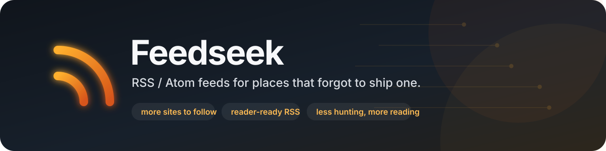

# Feedseek 📡

**Samoodświeżające się, ulepszane feedy RSS/Atom + JSON oraz dedykowane Model Feeds dla LLM-ów i agentów: zarówno tam, gdzie feedu brakuje, jak i tam, gdzie natywny da się zrobić lepiej.**

    
  
  
 

**Polski** · [English](README.md) · [简体中文](README_zh.md)  

[**📡 Feedy**](https://trvny.github.io/feedseek/) · [**📖 Czytnik**](https://trvny.github.io/feedseek/reader/) · [**🗂 Rejestr**](feeds.yaml) · [**🧭 Technicznie**](docs/)  

Feedseek wyszukuje albo buduje feedy, normalizuje wpisy, usuwa duplikaty i publikuje wynik przez GitHub Pages. Harmonogram odświeża źródła co dwie godziny, a awaria jednego serwisu nie powinna wywracać pozostałych.

Feedseek nie jest tylko generatorem dla stron, które nie mają feedu. Natywny RSS/Atom jest wartościowym źródłem wejściowym, ale nie nietykalnym produktem końcowym: jeśli materiał źródłowy na to pozwala, Feedseek normalizuje i wzbogaca go do stabilniejszej, pełniejszej, bogatszej semantycznie i bardziej interoperacyjnej postaci, publikując obok XML także JSON Feed 1.1. Każdy feed dostaje też `feed_<name>.model.json`: zwarty Model Feed z oczyszczonym tekstem i jawną informacją, czy wpis zawiera treść, streszczenie czy tylko tytuł, przeznaczony bezpośrednio do konsumpcji przez modele i agentów.

Celem jest wykorzystywanie możliwości RSS, Atom i JSON Feed tak dobrze, jak pozwalają dane źródłowe: trwałe identyfikatory, kanoniczne linki, prawdziwe daty publikacji i aktualizacji, użyteczne metadane, pochodzenie, kategorie oraz media. Scrapery i adaptery API uzupełniają braki natywnych źródeł. Nieudane albo puste pobranie nie zastępuje ostatniego poprawnego feedu.

## Feedy

<!-- registry-count: feeds.yaml (112 źródeł) -->
Pełna tabela źródeł i bezpośrednich plików feedów znajduje się w [angielskim README](README.md#feeds-), a wygodniejszy interfejs do przeglądania i subskrypcji na [stronie Feedseek](https://trvny.github.io/feedseek/).

- **Rejestr:** [`feeds.yaml`](feeds.yaml)
- **Wygenerowane XML/JSON/Model Feed:** [`feeds/`](feeds/)
- **Indeks źródeł:** [`docs/sources.md`](docs/sources.md)
- **Notatki o poszczególnych feedach:** [`docs/feeds.md`](docs/feeds.md)

## Dokumentacja

- [Pipeline, enrichment, użycie lokalne i układ repozytorium](docs/architecture.md)
- [Źródła i kompromisy poszczególnych feedów](docs/feeds.md)
- [Działanie i utrzymanie cache](docs/cache.md)
- [Wygenerowany indeks źródeł](docs/sources.md)

Androidowy czytnik/player tych feedów to osobny projekt: **[travnie/kanarek](https://github.com/travnie/kanarek)**.

## [Licencja](LICENSE)

  [THIRD_PARTY_NOTICES](docs/THIRD_PARTY_NOTICES.md)

## 📰 Mininewsy

<!--README_FEED:START-->
- [Star History Monthly October 2026 | Execution](https://www.star-history.com/blog/execution)
- [Time for Saudi Clarity on Normalization with Israel](https://carnegieendowment.org/research/2026/10/time-for-saudi-clarity-on-normalization-with-israel)
- [mergify unlabeled PR #343 in travnie/twojstar](https://github.com/travnie/twojstar#feedseek-event-18066715698)
- [trvny merged PR #343 in travnie/twojstar](https://github.com/travnie/twojstar#feedseek-event-18066712177)
- [mergify labeled PR #343 in travnie/twojstar](https://github.com/travnie/twojstar#feedseek-event-18066706567)
- [Russia, Ukraine agree on ceasefire in embattled town, to hold peace talks next month](https://www.reuters.com/world/europe/russia-ukraine-agree-ceasefire-embattled-town-hold-peace-talks-next-month-2026-10-23/)
<!--README_FEED:END-->

## 💬 Cytat z szuflady

<!-- markdownlint-disable MD033 -->
<!--STARTS_HERE_QUOTE_README-->
<i>❝E-Mail was invented before Internet. Shocked!!!! ” I also got shocked after hearing this.”❞</i>
<!--ENDS_HERE_QUOTE_README-->
<!-- markdownlint-enable MD033 -->

## Other stuff

 
